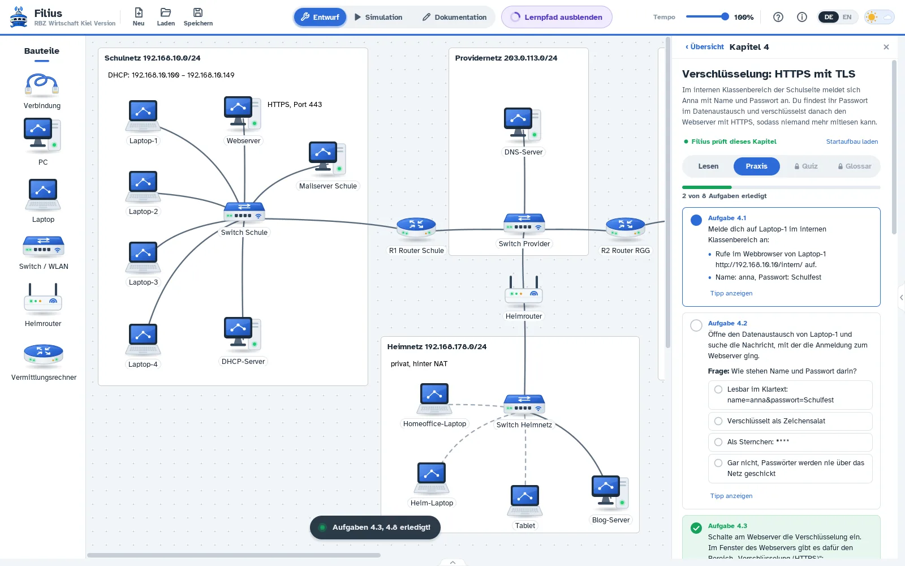
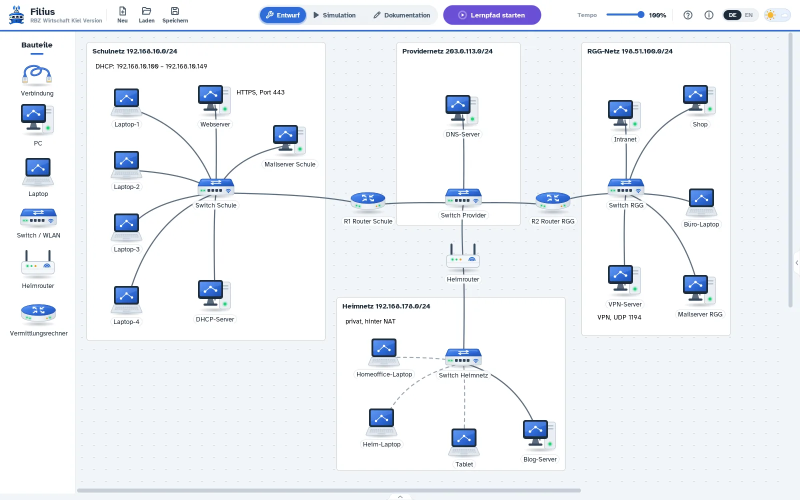

# Filius (RBZ Wirtschaft Kiel Version)

**Deutsch** · [English](#english)

Filius ist eine Lernsoftware zu Rechnernetzen: Man baut aus Laptops, Switches, Routern und Servern ein
eigenes Netz und sieht jedem Datenpaket zu. Diese Version von **Filius 2.9.3** hat eine überarbeitete
Oberfläche und einen **Lernpfad** in zwei Stufen (Standard mit 8, Fortgeschritten mit 12 Kapiteln), der
von der ersten IP-Adresse bis zu HTTPS, Firewall und VPN führt – auf Deutsch und Englisch.



- **Download und Installationshinweise:** https://www.demand-unterricht.de/projekte/filius
  und unter [Releases](https://github.com/DemandGames/filius-rbz/releases)
- Windows 10/11, macOS 11 oder neuer (Apple-Chip und Intel), Linux (.deb), jeweils 64 Bit;
  eine Java-Installation ist nicht nötig, jedes Paket bringt seine eigene Laufzeit mit.
- **Klausurversion für Windows:** `Filius-RBZ-Klausur.exe` – eine einzige Datei, ohne Installation, die
  z. B. im Aufgabenordner liegt. Gleiches Programm, aber ohne Lernpfad (auch nicht aus Projektdateien mit
  Fortschritt), ohne Beispiele und ohne Tipps in der Hilfe. „Laden“ und „Speichern“ zeigen zuerst den Ordner
  der Datei.

## Was ist neu gegenüber Filius 2.9.3?

- Lernpfad neben dem Netz: Lesen, Praxis, Quiz und Glossar; Filius prüft die Aufgaben im laufenden Netz
- modernes Design (hell und dunkel), neue Symbole, Kopfleiste mit Neu/Laden/Speichern, Hilfe neu
- HTTPS mit TLS und Zertifikaten, VPN-Server und -Client, E-Mail mit IMAP, Firewall und Portfreigabe
- Webbrowser mit WebKit-Engine, Datenaustausch im TCP/IP- oder OSI-Modell, Text-Editor mit Syntaxfarben
- Pakete fliegen sichtbar über Kabel und WLAN
- Speichern nur in der Projektdatei (.fls) – geeignet für Terminalserver

Technisch bleibt das originale `filius.jar` unverändert; `filius-rbz.jar` wird im Klassenpfad davor geladen
und ergänzt bzw. ersetzt einzelne Klassen (Einzelheiten in [BUILD.md](BUILD.md)).

## Bauen

Alles wird automatisch auf GitHub gebaut ([.github/workflows/build.yml](.github/workflows/build.yml)).
Von Hand unter Linux:

```
tools/deps.sh && tools/runtimes.sh && ./package.sh
installer/build-setup.sh && installer/build-mac.sh && installer/build-deb.sh
```

Die Ergebnisse liegen in `out/`. Abhängigkeiten werden mit festen SHA-256-Prüfsummen geladen
(`tools/deps.sh`); die Programmdateien des originalen Filius 2.9.3 liegen unverändert in
[`third_party/filius-2.9.3`](third_party/filius-2.9.3).

## Lizenz

Filius (RBZ Wirtschaft Kiel Version) ist eine Weiterentwicklung von [Filius](https://www.lernsoftware-filius.de)
(© Stefan Freischlad, Universität Siegen u. a.) und steht wie dieses unter der GNU GPL (v2 oder v3,
siehe [LICENSE](LICENSE)). Bestandteile: FlatLaf (Apache 2.0), Schriften Atkinson Hyperlegible und
JetBrains Mono (SIL OFL 1.1), OpenJFX und Java-Laufzeit (GPL v2 mit Classpath Exception), Bibliotheken von
Filius in `third_party/filius-2.9.3/lib` (jeweils eigene Open-Source-Lizenzen). Grafiken und Logos dieser
Version: CC BY 4.0.

## Code signing policy

Free code signing provided by [SignPath.io](https://about.signpath.io), certificate by
[SignPath Foundation](https://signpath.org) *(beantragt / applied for)*.

- Committers and reviewers: [DemandGames](https://github.com/DemandGames)
- Approvers: [DemandGames](https://github.com/DemandGames)

Signiert werden nur die Windows-Dateien (Starter „Filius RBZ.exe“, die beiden Installer und die
Klausurversion „Filius-RBZ-Klausur.exe“), die der Workflow dieses Repositorys aus dem Quellcode baut. Jede
Signatur wird von Hand freigegeben.
Only the Windows files (starter, installers and exam edition) built by this repository's workflow are
signed; every signing request is approved manually.

## Datenschutz / Privacy policy

Dieses Programm überträgt keine Informationen an andere Rechner im Netzwerk oder im Internet, es sei denn,
die Benutzerin oder der Benutzer verlangt es ausdrücklich. Alle Netze, Server und Webseiten in Filius sind
simuliert und laufen nur im Programm.

This program will not transfer any information to other networked systems unless specifically requested
by the user or the person installing or operating it. All networks, servers and web pages in Filius are
simulated inside the program.

---

## English

Filius is learning software about computer networks: build your own network of laptops, switches, routers
and servers and watch every packet. This version of **Filius 2.9.3** has a redesigned user interface and a
**learning path** in two levels (standard with 8 and advanced with 12 chapters), from the first IP address
to HTTPS, firewalls and VPN – in German and English.



- **Download:** https://www.demand-unterricht.de/projekte/filius and
  [Releases](https://github.com/DemandGames/filius-rbz/releases)
- Windows 10/11, macOS 11 or later (Apple silicon and Intel), Linux (.deb), 64 bit; no Java installation
  needed.
- **Exam edition for Windows:** `Filius-RBZ-Klausur.exe` – one file, no installation, without the learning
  path (also not from project files with progress), examples and help tips.
- Build: see [BUILD.md](BUILD.md) and the workflow in `.github/workflows/build.yml`.
- Licence: GNU GPL v2 or v3, like Filius. The original `filius.jar` stays unchanged; `filius-rbz.jar` is
  loaded in front of it.
